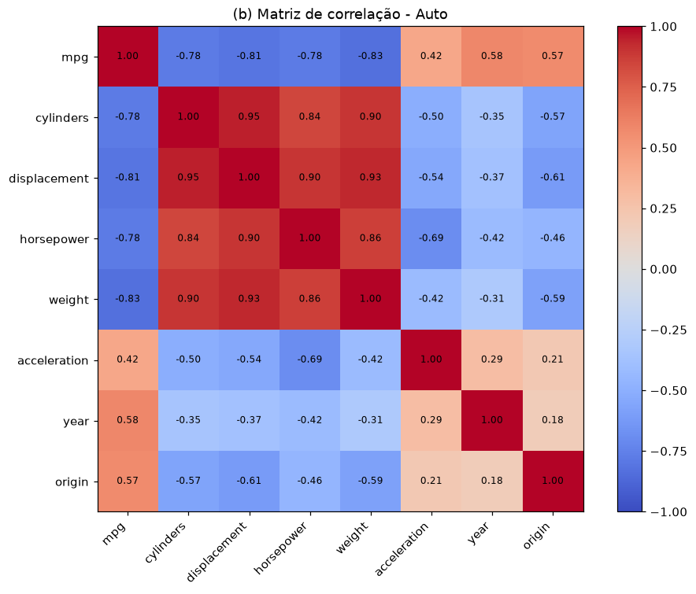
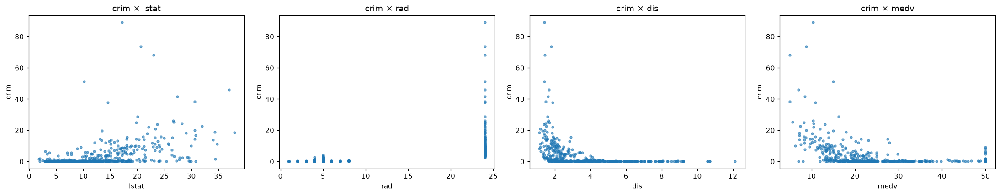
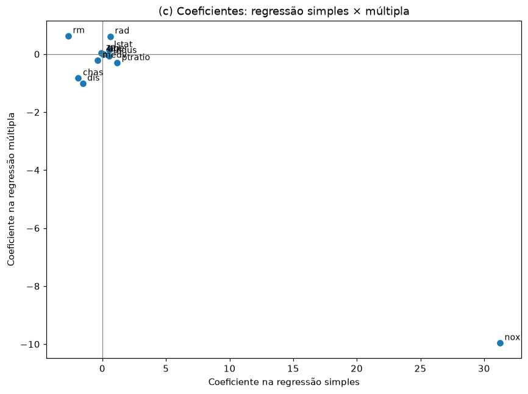
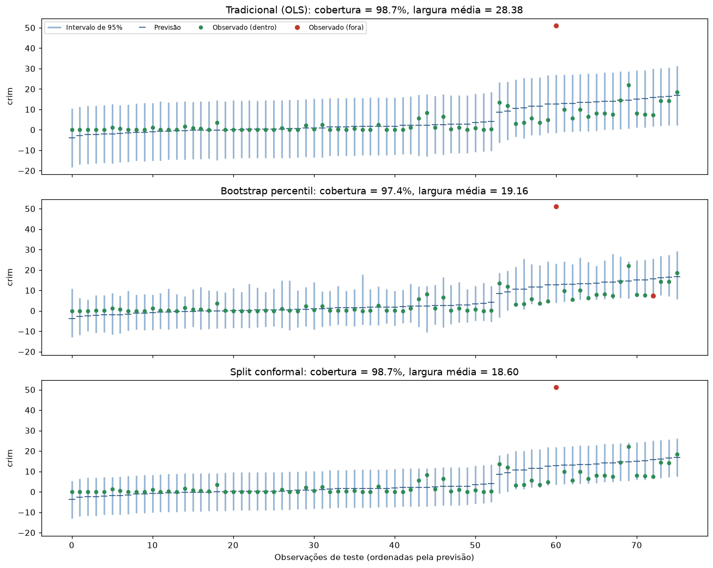

# Regressão Linear e Intervalos de Previsão

Regressão linear simples, múltipla e polinomial nas bases **Auto** e **Boston**, e comparação de três métodos de intervalo de previsão: tradicional (OLS), bootstrap percentil e *split conformal prediction*.

## Estrutura

```
regressao-linear-intervalos-previsao/
├── data/
│   ├── Auto.csv
│   └── Boston.csv
├── src/
│   ├── config.py                # caminhos, semente, alpha, nº de réplicas
│   ├── data.py                  # leitura das bases
│   ├── utils.py                 # salvar tabelas e figuras
│   ├── auto_regression.py       # Questão 2
│   ├── boston_regression.py     # Questão 3
│   └── prediction_intervals.py  # Questão 4
├── tests/
│   └── test_prediction_intervals.py
├── results/
│   ├── figures/                 # gráficos gerados
│   └── tables/                  # tabelas em CSV
├── main.py
├── requirements.txt
└── README.md
```

Os sumários dos modelos aparecem no terminal. As tabelas e os gráficos são salvos em `results/`.

---

## Regressão linear múltipla (Auto)

A resposta é `mpg` (milhas por galão), e os preditores são todas as demais variáveis, exceto `name`. A base tem 392 carros.



`mpg` tem forte correlação negativa com `weight` (−0,83), `displacement` (−0,81), `horsepower` e `cylinders` (−0,78). Essas quatro variáveis também são muito correlacionadas entre si.

**(i) Existe relação entre preditores e resposta?** Sim. O teste F global tem F = 252,4 e p-valor ≈ 2 × 10⁻¹³⁹, e o modelo explica 82% da variância de `mpg` (R² = 0,82).

**(ii) Quais preditores são significativos?** A 1%, são `weight`, `year`, `origin` e `displacement`. Os preditores `cylinders`, `horsepower` e `acceleration` não são significativos quando os demais estão no modelo, o que se explica pela forte colinearidade entre as variáveis de motor.

**(iii) O que o coeficiente de `year` sugere?** Mantidos os demais fatores, cada ano a mais de fabricação está associado a +0,75 mpg. Carros mais novos são mais eficientes.

**(d) Transformações**

| Modelo | R² | R² ajustado | AIC |
|---|---|---|---|
| Original | 0,822 | 0,818 | 2063,0 |
| Com log(horsepower), log(weight) | 0,852 | 0,849 | 1990,0 |
| Com horsepower², weight² | 0,864 | 0,861 | 1959,9 |

Os dois modelos com transformações melhoram o ajuste, e os termos quadráticos são altamente significativos (p < 10⁻⁵). A relação entre `mpg` e as variáveis de potência/peso é curva: o ganho de eficiência ao reduzir o peso diminui à medida que o carro fica mais leve.

> `origin` é codificada como 1 (EUA), 2 (Europa) e 3 (Japão), mas entrou no modelo como numérica, mantendo a especificação original da lista. Tratá-la como categórica (`C(origin)`) seria uma extensão natural.

## Preditores da criminalidade (Boston)

A resposta é `crim` (taxa de criminalidade per capita). A base tem 506 bairros e 12 preditores.

**(a) Regressões simples.** Todos os preditores, exceto `chas` (proximidade do rio Charles, p = 0,21), têm associação significativa com `crim` a 5%. Os mais fortes são `rad` (acesso a rodovias, R² = 0,39) e `tax` (R² = 0,34). `dis` e `medv` têm associação negativa: bairros mais distantes dos centros de emprego e com imóveis mais caros têm menos crime.



**(b) Regressão múltipla.** Rejeitamos H₀: βⱼ = 0 a 5% para `rad`, `dis`, `medv` e `zn`.

**(c) Simples × múltipla.** Dos 11 preditores significativos isoladamente, só 4 continuam significativos no modelo múltiplo. Vários coeficientes mudam de sinal (`nox`, `rm`, `zn`, `indus`, `ptratio`, `tax`, `age`). Isso mostra que, nas regressões simples, cada variável capta o efeito de outras correlacionadas com ela: `nox`, `indus`, `tax` e `rad`, por exemplo, descrevem juntas as áreas industriais e centrais.



**(d) Não linearidade.** No modelo `crim ~ X + X² + X³`, há termos quadráticos ou cúbicos significativos (5%) para `indus`, `nox`, `age`, `dis`, `ptratio` e `medv`. Para `chas`, que é binária, o modelo polinomial não se aplica, porque X² = X³ = X.

## Intervalos de previsão para `crim`

Os dados foram divididos em treino (70%, 354 observações), calibração (15%, 76) e teste (15%, 76). O modelo é a regressão múltipla com todos os preditores, e o nível nominal é de 95%.

| Método | Cobertura no teste | Largura média |
|---|---|---|
| Tradicional (OLS) | 98,7% | 28,38 |
| Bootstrap percentil (corrigido) | 97,4% | 19,16 |
| Split conformal | 98,7% | 18,60 |
| *Bootstrap original (com erro)* | *46,1%* | *5,19* |



### Interpretação

Os três métodos corretos atingem a cobertura nominal, mas o intervalo tradicional é ~50% mais largo. Ele supõe erros normais e com variância constante, e `crim` viola as duas suposições: é muito assimétrica, com a maioria dos bairros perto de zero e alguns acima de 50. Os resíduos grandes inflam a variância estimada, e o intervalo fica largo para todos.

O split conformal não depende dessas suposições e garante cobertura média de pelo menos 95% em amostras finitas, só com a hipótese de que os dados são trocáveis. Ele chega ao mesmo resultado com intervalos mais estreitos. Sua limitação é ter a mesma largura para todas as observações.

O bootstrap corrigido também fica perto do nominal e produz larguras que variam entre observações.

Com 76 observações de teste, cada ponto vale ~1,3 p.p. de cobertura, então diferenças pequenas entre os métodos não são conclusivas.

Em todos os métodos, mais de 70% dos limites inferiores são negativos, o que é impossível para uma taxa. Modelar `log(crim)` ou usar um escore conformal normalizado (ou regressão quantílica) seria o próximo passo para obter intervalos mais justos e adaptados a cada bairro.

## Ferramentas

Python, pandas, NumPy, statsmodels, scikit-learn, Matplotlib e pytest.
